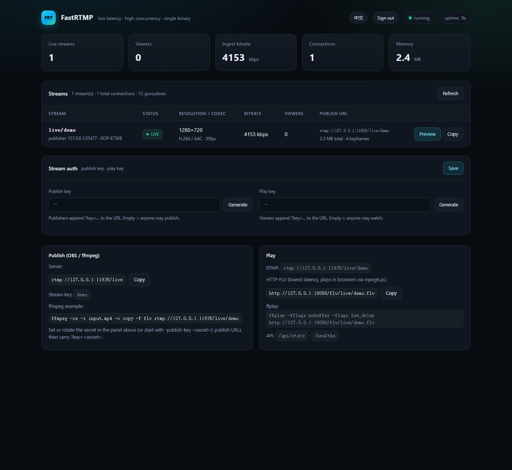

# FastRTMP

**English** · [简体中文](README.zh-CN.md)


A low-latency, high-concurrency RTMP live server written from scratch in Go.

It speaks RTMP on the wire — handshake, chunk stream, AMF0, the command state machine — instead of  
wrapping an existing SDK. One static binary, zero third-party dependencies, no transcode, no  
external database. Push from OBS or ffmpeg, play over RTMP or HTTP-FLV, and watch it in the built-in  
dashboard.



```
                    ┌───────────────────────────────────────────┐
  OBS / ffmpeg      │               FastRTMP                    │      RTMP players (ffplay/VLC)
  ──── publish ───► │  ingest ──► Stream ──► fan-out ───────────┼──►
                    │              ├── GOP cache (instant start) │      HTTP-FLV (browser, ffplay)
                    │              └── per-viewer send queue     ├──►
                    └───────────────────────────────────────────┘
```

## Highlights

|                      |                                                                                                                                              |
| -------------------- | -------------------------------------------------------------------------------------------------------------------------------------------- |
| **Protocol**         | RTMP publish + play (simple handshake, compatible with OBS, ffmpeg, VLC, hardware encoders)                                                  |
| **Low latency**      | Forward-as-you-receive, no transcode, `TCP_NODELAY`. In-process relay **p50 ≈ 0.3 ms**, p95 ≈ 1.5 ms                                         |
| **High fan-out**     | One shared payload buffer for all viewers (zero-copy), independent queue per viewer. 500 concurrent viewers measured with 0 dropped sessions |
| **Instant start**    | Metadata + codec config + last GOP are cached per stream, so a new viewer decodes immediately                                                |
| **Slow-client safe** | A backlogged viewer is dropped to the next keyframe; it can never slow down ingest or other viewers                                          |
| **HTTP-FLV**         | Play in a browser via mpegts.js, or with `ffplay`, ~0.5–1 s latency, no WebRTC signalling                                                    |
| **Dashboard**        | Live stream table, bitrate/FPS/resolution, viewer count, in-page preview. Bilingual (EN/中文)                                                  |
| **Admin password**   | `-admin-password` puts a session-based login in front of the panel; rate-limited attempts, sign-out, and key editing disabled when no password is set |
| **Key rotation**     | Edit the publish/play keys from the panel; applies immediately, example URLs pick up `?key=` automatically                                     |
| **Ops**              | `/api/stats`, `/healthz`, optional pprof, `-publish-key` / `-play-key` auth                                                                  |
| **Listeners**        | Multi-address listen: `-listen dual` opens a public and a LAN door at once; a NATed public IP degrades gracefully with a forwarding hint      |
| **Deploy**           | Single binary for Linux (amd64/arm64), Windows, macOS; systemd unit, Dockerfile, cross-compile script                                        |

## Benchmarks

Measured on a Windows 11 laptop, loopback, using the bundled `rtmptest` client. The relay itself  
does not buffer, so numbers are dominated by the kernel networking path.

| Scenario                  | p50         | p95     | p99     | Notes                              |
| ------------------------- | ----------- | ------- | ------- | ---------------------------------- |
| 1 publisher → 1 viewer    | **0.29 ms** | 1.5 ms  | 1.8 ms  | 30 fps, 20 KB frames               |
| 1 publisher → 200 viewers | 3.0 ms      | 7.1 ms  | 9.0 ms  | 5,916 frames/s aggregate           |
| 1 publisher → 500 viewers | 8.3 ms      | 15.7 ms | 18.8 ms | 10,761 frames/s, 0 failed sessions |

The 500-viewer run has the test client on the same machine, so those numbers include client-side  
CPU contention and should be read as an upper bound.

### Real encoder verification

Every row below was executed against this server, not inferred:

| Check                                                                       | Result                                                              |
| --------------------------------------------------------------------------- | ------------------------------------------------------------------- |
| `ffmpeg ... -f flv rtmp://127.0.0.1:1935/live/ffmpeg` (1080p30 H.264 + AAC) | accepted, server reports H.264/AAC, 30 fps, 4.1 Mbps                |
| `ffprobe rtmp://.../live/ffmpeg`                                            | `h264 1920x1080 30/1` + `aac`                                       |
| `ffprobe http://.../flv/live/ffmpeg.flv`                                    | `h264 1920x1080 30/1` + `aac`                                       |
| `ffmpeg -i <http-flv> -t 6 -f null -`                                       | **zero warnings, zero decode errors**                               |
| Record 6 s from HTTP-FLV                                                    | 180 video frames (= 30 × 6), 258 audio frames, duration 6.000 s     |
| Record 5 s from RTMP                                                        | 150 video frames, 215 audio frames, duration 5.009 s                |
| Publish with a wrong/missing `?key=`                                        | rejected with `invalid publish key`; correct key publishes normally |
| Viewer connects before the publisher                                        | starts playing by itself once the publisher appears, no reconnect   |

## Quick start

### Build

```bash
git clone https://github.com/Hydroxide-OH/FastRTMP.git
cd FastRTMP

go build -o bin/fastrtmp ./cmd/fastrtmp          # or: make build
./bin/fastrtmp -version
```

Cross-compile everything (Linux amd64/arm64, Windows, macOS):

```bash
./build.sh          # artifacts land in dist/
```

### Run

```bash
./bin/fastrtmp                    # :1935 RTMP, :8080 HTTP, all interfaces
./bin/fastrtmp -addr :1935 -http :8080 -log-level info
```

The banner prints ready-to-use public, LAN and loopback URLs:

```
  FastRTMP v1.1.0  ·  low-latency RTMP server
  ─────────────────────────────────────────────────────────
  Mode        all interfaces
  RTMP        :1935  ·  HTTP  :8080

  Public      rtmp://203.0.113.7:1935/live/{stream}
              http://203.0.113.7:8080  (dashboard + /flv/live/{stream}.flv)
  LAN         rtmp://192.168.1.10:1935/live/{stream}
              http://192.168.1.10:8080
  Local       rtmp://127.0.0.1:1935/live/{stream}
  Dashboard   http://127.0.0.1:8080/  (no password, key editing disabled)
  Health      http://127.0.0.1:8080/healthz
```

### Public + LAN listeners

One flag opens the public and the LAN door at the same time:

```bash
./bin/fastrtmp -listen dual                 # = -addr public:1935,lan:1935
./bin/fastrtmp -listen dual -addr :1940 -http :8081
./bin/fastrtmp -addr public:1935,lan:19350  # explicit list, ports may differ
```

`-addr` and `-http` both take a comma separated list. Each entry is one of:

| Form | Meaning |
| --- | --- |
| `:1935`, `1935`, `0.0.0.0:1935` | every interface (the historical behaviour) |
| `public:1935`, `public` | the internet-facing address, port optional (1935 / 8080) |
| `lan:1935`, `lan` | the local network address |
| `192.168.1.10:1935` | that address verbatim, no resolution |

Behaviours worth knowing:

- **A public address that is not on a local NIC degrades instead of failing.** Behind a home
  router or a 1:1 NAT cloud instance the public IP lives on the gateway, so binding it is
  impossible. `public:` then falls back to a wildcard bind, logs a WARN and the banner tells you
  to set up port forwarding. On a VPS, where the public IP is on the interface, it binds exactly.
- **A wildcard bind on a port wins over specific addresses on the same port** (`:1935,192.168.1.10:1935`
  keeps only the former), otherwise the kernel returns `address already in use`.
- **The public and LAN listeners are two doors to one server**: streams, viewers, auth and stats
  are shared. They are not separate instances.
- Public IP detection races five echo services with a 4s cap and never blocks startup.
  Use `-public-ip off` to skip it, or `-public-ip 203.0.113.7` to pin it.
- The LAN address is taken from the interface carrying the default route; VirtualBox / VMware /
  Hyper-V / WSL adapters are ranked last so the banner never advertises an unreachable address.

### Publish

**OBS** — Settings → Stream → Service: `Custom…`

- Server: `rtmp://<your-ip>:1935/live`
- Stream key: `test` (or any name)

**ffmpeg** — loop a file:

```bash
ffmpeg -re -stream_loop -1 -i input.mp4 -c copy -f flv rtmp://127.0.0.1:1935/live/test
```

**ffmpeg** — low-latency camera capture (Linux `v4l2` shown; use `dshow` on Windows, `avfoundation` on macOS):

```bash
ffmpeg -f v4l2 -i /dev/video0 -f alsa -i default \
  -c:v libx264 -preset veryfast -tune zerolatency -g 60 -b:v 2500k \
  -c:a aac -b:a 128k -f flv rtmp://127.0.0.1:1935/live/test
```

### Play

```bash
# Lowest latency: HTTP-FLV
ffplay -fflags nobuffer -flags low_delay -probesize 32 -analyzeduration 0 \
  http://127.0.0.1:8080/flv/live/test.flv

# RTMP
ffplay rtmp://127.0.0.1:1935/live/test
```

Open `http://127.0.0.1:8080` and hit **Preview** to watch in the browser (mpegts.js over HTTP-FLV).

## Latency: where the milliseconds go

The server adds well under a millisecond. Glass-to-glass latency is dominated by the encoder and the  
player:

| Stage        | Typical cost | How to reduce it                                                        |
| ------------ | ------------ | ----------------------------------------------------------------------- |
| Encoder      | 100–1000 ms  | `-tune zerolatency`, disable B-frames, GOP 1–2 s                        |
| **FastRTMP** | **< 1 ms**   | already minimal: no transcode, no jitter buffer                         |
| Player       | 300–1500 ms  | `-fflags nobuffer` for ffplay; `liveBufferLatencyChasing` for mpegts.js |

RTMP runs over TCP, so a lossy path will accumulate retransmission delay. If you need ~200 ms  
end-to-end on hostile networks, add a WebRTC output — that is out of scope here.

## How it stays fast

1. **Zero-copy fan-out.** Each media message is allocated once; every viewer shares the same payload  
   and only holds a pointer.
2. **Per-viewer queue and writer goroutine.** Ingest only enqueues; a blocked socket never stalls the  
   publisher or other viewers.
3. **Drop to keyframe.** When a viewer's backlog exceeds `-queue` (8 MB default), its queue is cleared  
   and it resumes at the next keyframe. Memory stays bounded and latency never grows without limit.
4. **GOP cache.** New viewers receive metadata → sequence headers → keyframe + following frames, so  
   they render immediately.
5. **One `write` per message.** A whole message is assembled into a single buffer and written in one  
   syscall, with `TCP_NODELAY`, removing Nagle-related jitter.
6. **Reader and writer are separate goroutines** per connection, so ingest never waits on the network  
   while assembling a message.
7. **fmt=0 chunk headers.** 11 extra bytes per message buys flat per-message latency and eliminates a  
   whole class of delta-timestamp bugs.

## Configuration

| Flag            | Default | Description                                                                           |
| --------------- | ------- | ------------------------------------------------------------------------------------- |
| `-addr`         | `:1935` | RTMP listen address; comma separated list, `public:` / `lan:` prefixes allowed (env `FASTRTMP_ADDR`) |
| `-http`         | `:8080` | HTTP listen address for dashboard + HTTP-FLV; same syntax as `-addr`; empty disables it (env `FASTRTMP_HTTP`) |
| `-listen`       | `all`   | Preset: `all`, `dual` (public + lan), `public`, `lan`; rewrites the host part of `-addr`/`-http`, keeping the port (env `FASTRTMP_LISTEN`) |
| `-public-ip`    | detect  | Public IP for `public:` targets and the banner; `off` disables detection (env `FASTRTMP_PUBLIC_IP`) |
| `-lan-ip`       | auto    | LAN IP for `lan:` targets (env `FASTRTMP_LAN_IP`)                                     |
| `-chunk-size`   | `4096`  | Outbound RTMP chunk size                                                              |
| `-queue`        | `8MB`   | Max per-viewer send backlog before drop-to-keyframe                                   |
| `-gop-cache`    | `4MB`   | Per-stream GOP cache budget                                                           |
| `-read-timeout` | `30s`   | Idle connection timeout; `0` disables                                                 |
| `-max-conns`    | `0`     | Max concurrent connections; `0` = unlimited                                           |
| `-max-viewers`  | `0`     | Max viewers per stream; `0` = unlimited                                               |
| `-publish-key`  | –       | Require `?key=<secret>` on publish URLs (env `FASTRTMP_PUBLISH_KEY`)                  |
| `-play-key`     | –       | Require `?key=<secret>` on play URLs (env `FASTRTMP_PLAY_KEY`)                        |
| `-admin-password` | –     | Dashboard password; unset leaves the panel open and disables key editing (env `FASTRTMP_ADMIN_PASSWORD`) |
| `-log-level`    | `info`  | `debug`, `info`, `warn`, `error`                                                      |
| `-pprof`        | –       | Enable pprof, e.g. `127.0.0.1:6060`                                                   |
| `-version`      |         | Print version and exit                                                                |

Sizes accept `8MB`, `512KB` or a raw byte count.

With auth enabled the URL carries the secret:

```bash
ffmpeg -re -i input.mp4 -c copy -f flv "rtmp://host:1935/live/test?key=s3cret"
```

## Dashboard password and key rotation

The dashboard on the `-http` port is open by default, which is fine on a trusted LAN.
Before exposing it to the internet, give it a password:

```bash
./fastrtmp -listen dual -admin-password 'your-strong-password'
# or via the environment, so the secret stays out of `ps`
FASTRTMP_ADMIN_PASSWORD='your-strong-password' ./fastrtmp -listen dual
```

With a password set:

- `/` answers `401` with an embedded login form until a session cookie is issued;
- the `fastrtmp_admin` cookie is `HttpOnly` + `SameSite=Strict`, lasts 12h sliding,
  and gains `Secure` automatically behind TLS;
- five wrong passwords from one IP lock that IP out for 30s (`429`), which stops
  online guessing;
- a "Sign out" button appears, revoking the session server side;
- `/api/stats` and `/api/config` are protected too — but `/healthz` and the
  `/flv/` stream paths are not, since those are guarded by `-play-key`.

**Without `-admin-password`** the panel still shows metrics, but the publish and play
keys are hidden and read-only, and `POST /api/config` returns `403`. That is deliberate:
a passwordless panel must never become a way to read or rotate the ingest secret.
The startup banner states which mode is active.

### Editing the stream keys from the panel

Once logged in, the "Stream auth" box edits the secrets in place:

| Action | Effect |
| --- | --- |
| Set publish key, save | Applies immediately; publishers must then send `?key=<new>`, the old one stops working |
| Set play key, save | Applies to both RTMP play and HTTP-FLV |
| "Generate" | Fills a random 16-char URL-safe key |
| Clear, save | Turns that check off — anyone may publish/watch (careful on the internet) |

The example ffmpeg and playback URLs on the page pick up `?key=` automatically, so
they stay copy-pasteable. Both keys hot-reload without a restart, but **live
connections are not torn down**: existing publishers and viewers keep their session
and only new connections are checked against the new key — the UI says so too.

Keys may not contain spaces, `?`, `&`, `=`, `#`, `%`, `+` or `/` (max 128 bytes) so they
can travel safely in a query string; non-ASCII characters such as Chinese are fine.

### Security boundaries

- The panel password guards the **management UI only**; RTMP ingest and HTTP-FLV
  playback are governed by `-publish-key` / `-play-key`.
- The password is never written to disk — only its hash, in process memory. Restart
  to reset it; there is no recovery flow, because this is a server, not a website.
- Prefer binding the panel to the LAN (`-http lan:8080`) or putting nginx with HTTPS
  in front, rather than publishing 8080 directly.

## HTTP API

| Path                      | Description                                     |
| ------------------------- | ----------------------------------------------- |
| `/`                       | Dashboard (login required when a password is set) |
| `/login`                  | Login page                                      |
| `/flv/{app}/{stream}.flv` | HTTP-FLV live stream, e.g. `/flv/live/test.flv` (`?key=` when `-play-key` is set) |
| `/live/{stream}.flv`      | Same, with `app` implied as `live`              |
| `/api/login`              | `POST {"password":"…"}` → session cookie        |
| `/api/logout`             | `POST` — revoke the session                     |
| `/api/config`             | `GET` config; `POST` rotates publish/play keys (login required) |
| `/api/stats`              | JSON metrics for the server and every stream (login required) |
| `/healthz`                | Health probe, returns `ok`, no login needed     |
| `/api/streams`            | Alias of `/api/stats`                           |

```json
{
  "uptime_sec": 188,
  "connections": 3,
  "stream_count": 1,
  "live_streams": 1,
  "total_viewers": 12,
  "goroutines": 29,
  "heap_mb": 11.4,
  "streams": [{
    "name": "live/test",
    "live": true,
    "publisher_addr": "10.0.0.5:52344",
    "viewers": 12,
    "bitrate_kbps": 2480,
    "fps": 30,
    "gop_cache_kb": 512,
    "codec_ready": true,
    "media": {
      "video_width": 1920, "video_height": 1080,
      "video_codec": "H.264", "audio_codec": "AAC"
    }
  }]
}
```

## Built-in load tester

`rtmptest` publishes synthetic frames with a wall-clock stamp inside each frame, so it can measure  
true one-way latency without any media tooling:

```bash
# publish 30 fps / 20 KB frames for 30 s
./bin/rtmptest -mode push -url rtmp://127.0.0.1:1935/live/test -duration 30s -fps 30

# single viewer, latency percentiles
./bin/rtmptest -mode pull -url rtmp://127.0.0.1:1935/live/test -duration 10s

# 500 concurrent viewers
./bin/rtmptest -mode load -url rtmp://127.0.0.1:1935/live/test -viewers 500 -duration 10s -quiet

# publisher + 20 viewers in one command
./bin/rtmptest -mode both -url rtmp://127.0.0.1:1935/live/test -viewers 20 -duration 15s
```

The first two seconds of each viewer are excluded from latency stats on purpose: a new viewer starts  
from the GOP cache, so it intentionally consumes up to one GOP of already-buffered media.


## Deployment

### Linux (systemd)

```bash
sudo useradd --system --no-create-home --shell /usr/sbin/nologin fastrtmp
sudo install -m 0755 dist/fastrtmp-1.1.0-linux-amd64/fastrtmp /usr/local/bin/fastrtmp
sudo install -m 0644 deploy/fastrtmp.service /etc/systemd/system/fastrtmp.service
sudo systemctl daemon-reload
sudo systemctl enable --now fastrtmp
sudo journalctl -u fastrtmp -f
```

Open `1935/tcp` (RTMP) and `8080/tcp` (HTTP) in your firewall.

### Reaching it from the internet

Listening on a public address and being reachable from the internet are two different things.
The server can only open the sockets; three more steps live outside it:

1. **Host firewall** — `ufw allow 1935/tcp && ufw allow 8080/tcp`, or
   `firewall-cmd --add-port=1935/tcp --permanent`.
2. **Cloud security group** — Aliyun/Tencent Cloud/AWS only open 22 by default; add inbound TCP
   1935 and 8080.
3. **Port forwarding** — behind a home router or a 1:1 NAT instance the public IP is not on your
   NIC, so forward 1935 and 8080 to the host's LAN address. `public:` detects this, degrades to a
   wildcard bind and says so in the banner.

Debug in this order, it tells you which layer is broken:

```bash
ss -lntp | grep -E '1935|8080'                  # 1. are the sockets open?
curl -s http://127.0.0.1:8080/healthz           # 2. is the process alive?
curl -s http://<lan-ip>:8080/healthz            # 3. does the LAN reach it?
curl -s http://<public-ip>:8080/healthz         # 4. does the internet reach it?
```

Only step 4 failing while 3 works is always firewall / security group / forwarding - no code change
needed. If you would rather not expose the dashboard, keep HTTP on loopback:

```bash
./bin/fastrtmp -addr public:1935,lan:1935 -http 127.0.0.1:8080
```

### Windows

```bat
:: run in the foreground
fastrtmp.exe -addr :1935 -http :8080

:: or register a service with NSSM
nssm install FastRTMP "C:\fastrtmp\fastrtmp.exe" "-addr :1935 -http :8080 -log-level info"
nssm start FastRTMP
```

### Docker

```bash
docker build -t fastrtmp .
docker run -d --name fastrtmp -p 1935:1935 -p 8080:8080 fastrtmp
```

### Reverse proxy note

HTTP-FLV is a long-lived chunked response. When fronting it with nginx, disable buffering:

```nginx
location /flv/ {
    proxy_pass http://127.0.0.1:8080;
    proxy_buffering off;
    proxy_cache off;
    chunked_transfer_encoding on;
    proxy_read_timeout 1h;
}
```

## Production notes

- **Single node capacity.** With a 5 Mbps stream, a 1 Gbps NIC can theoretically serve ~180 replicated  
  outputs. CPU is mostly spent in the kernel network stack; `-chunk-size 4096` keeps syscall overhead low.
- **Scaling out.** Shard by stream name (consistent hashing) behind an L4 load balancer; HTTP-FLV is  
  easy to put behind a CDN.
- **Auth.** `-publish-key` is a static shared secret, good enough for private or internal use. For public  
  deployments put a token check in front (nginx `auth_request`, or your own auth service).
- **Monitoring.** Poll `/api/stats` (json_exporter, or your own scrape) and watch `viewers`,  
  `bitrate_kbps`, `goroutines`, `heap_mb`.
- **TLS.** RTMPS is not built in; terminate TLS with nginx `stream` + `ssl_preread`, or stunnel, if needed.
- **No recording, no HLS, no transcode.** FastRTMP is a relay. Pair it with ffmpeg for recording or  
  packaging if you need those.

## Repository layout

```
FastRTMP/
├── cmd/fastrtmp/           # server entry point (flags, banner, signals)
├── cmd/rtmptest/           # publish / play / load-test client
├── internal/rtmp/
│   ├── amf0.go             # AMF0 encoder/decoder
│   ├── chunk.go            # RTMP chunking and reassembly
│   ├── conn.go             # connection state machine and commands
│   ├── client.go           # RTMP client used by tests and the load tool
│   ├── stream.go           # stream registry, GOP cache, viewer fan-out
│   ├── server.go           # listener binding, stats, lifecycle
│   ├── listen.go           # listen-address resolution (:port / public: / lan: / lists)
│   ├── netinfo.go          # interface enumeration, public IP detection
│   ├── auth.go             # admin password, sessions, stream-key store
│   ├── flv.go              # HTTP-FLV output (checks the play key)
│   ├── web.go              # embedded dashboard, login and config endpoints
│   ├── web/index.html      # dashboard (bilingual, edits the stream keys)
│   └── web/login.html      # login page
├── deploy/fastrtmp.service # systemd unit
├── docs/                   # screenshots
├── Dockerfile
├── Makefile
└── build.sh                # cross-compile release artifacts
```

## Protocol coverage

- Handshake: RTMP simple handshake (S1/S2 echo C1). ffmpeg, OBS and friends fall back to it after  
  validating S1; verified with ffmpeg 4.x.
- Chunk stream: fmt 0/1/2/3, extended timestamps, reassembly, `SetChunkSize` in both directions.
- AMF0: number, boolean, string, object, ECMA array, strict array, null, undefined, date, long string.
- Commands: `connect`, `releaseStream`, `FCPublish`, `FCUnpublish`, `createStream`, `publish`, `play`,  
  `deleteStream`, `closeStream`, `getStreamLength`, `pause`.
- Messages: audio, video, data (incl. `@setDataFrame`), aggregate unpacking, window ack +  
  acknowledgement.
- Not implemented: RTMPS/RTMPT, HLS/DASH, transcoding, recording, DVR.

## Roadmap

- [ ] Optional RTMPS listener
- [ ] HLS output for CDN-friendly delivery
- [ ] Recording (FLV/MP4 segmenter)
- [ ] Prometheus metrics endpoint
- [ ] Admin API for kicking publishers/viewers
- [ ] Complex (digest) handshake for clients that require it

## Contributing

Issues and pull requests are welcome. Before sending a PR:

```bash
gofmt -l .          # should print nothing
go vet ./...
go test ./... -count=1
```

Please keep the protocol code dependency-free and add a test for every behaviour change.

## License

[MIT](LICENSE) © 2026 Hydroxide-OH
