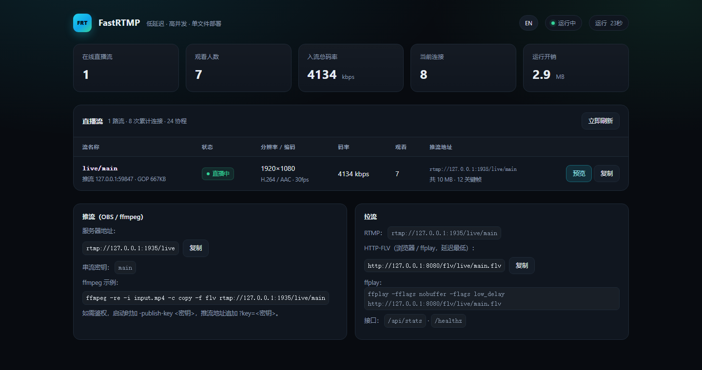
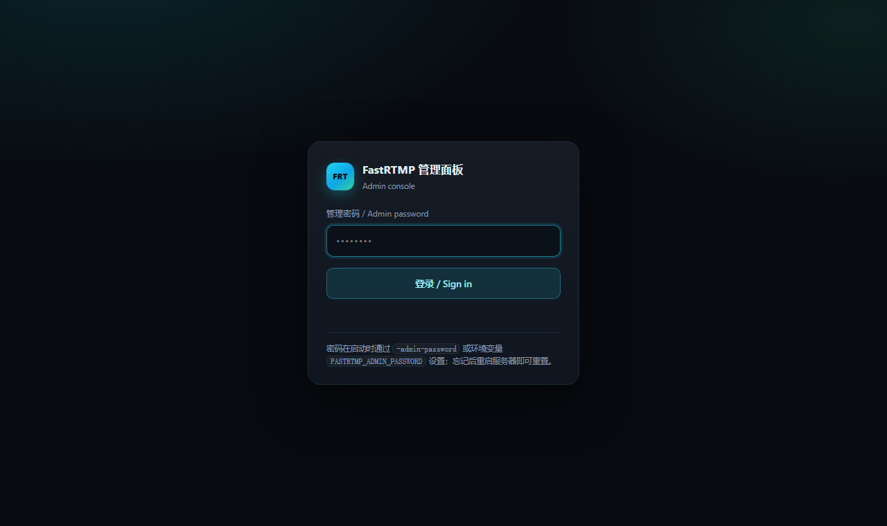
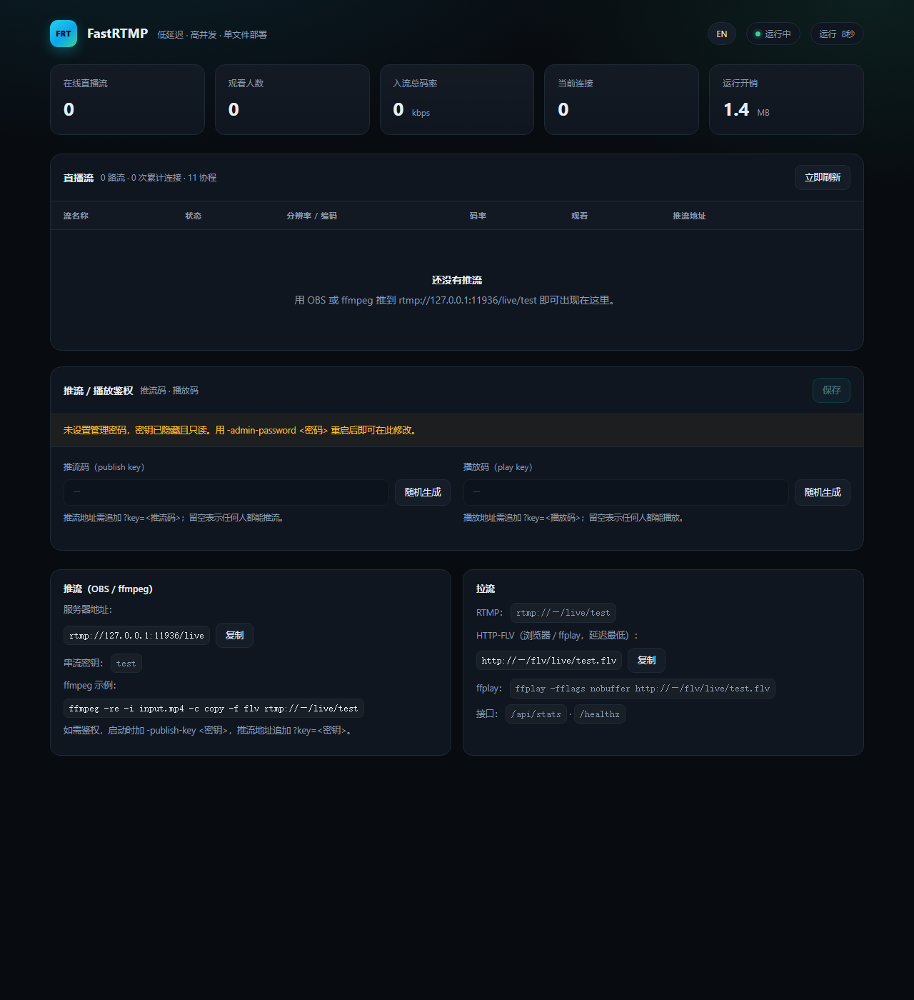
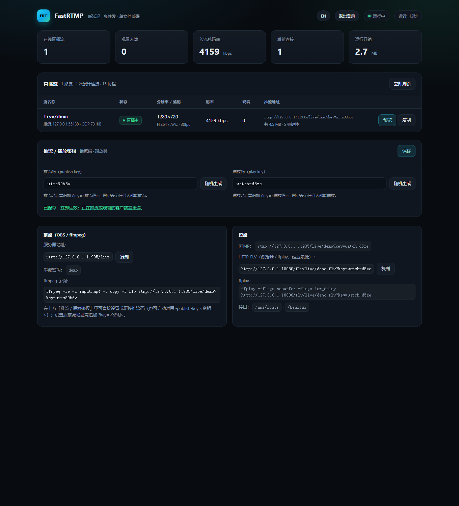

# FastRTMP

[English](README.md) · **简体中文**

[](https://github.com/Hydroxide-OH/FastRTMP/actions/workflows/ci.yml)
[](https://go.dev)
[](LICENSE)
[](#部署)

用 Go 从零实现的低延迟、高并发 RTMP 直播服务器。

握手、chunk 分块、AMF0、命令状态机都是自己写的，没有包一层现成 SDK。单个静态二进制、零第三方
依赖、不转码、不需要外部数据库。OBS 或 ffmpeg 推流，RTMP 或 HTTP-FLV 拉流，自带仪表盘看状态。



加密码后进入面板要先登录：



```
                    ┌───────────────────────────────────────────┐
  OBS / ffmpeg      │               FastRTMP                    │      RTMP 播放器 (ffplay/VLC)
  ──── 推流 ───────► │  接入 ──► Stream ──► 扇出 ────────────────┼──►
                    │            ├── GOP 缓存（秒开）            │      HTTP-FLV（浏览器、ffplay）
                    │            └── 每观众独立发送队列           ├──►
                    └───────────────────────────────────────────┘
```

## 特性

| | |
| --- | --- |
| **协议** | RTMP 推流 + 拉流（simple handshake，兼容 OBS、ffmpeg、VLC、硬件编码器） |
| **低延迟** | 边收边转、不转码、`TCP_NODELAY`；机内中继 **p50 ≈ 0.3ms**，p95 ≈ 1.5ms |
| **高并发** | 所有观众共享同一份消息缓冲（零拷贝），每人独立队列；500 观众实测 0 掉线 |
| **秒开** | 每路流缓存 metadata + 编码配置 + 最近一个 GOP，新观众立刻出画面 |
| **慢客户端保护** | 积压超限的观众被丢到下一个关键帧，绝不拖慢推流端和其他观众 |
| **HTTP-FLV** | 浏览器（mpegts.js）或 ffplay 直接播放，延迟约 0.5–1s，不需要 WebRTC 信令 |
| **仪表盘** | 流列表、码率/帧率/分辨率、观众数、页内预览，中英双语可切换 |
| **管理密码** | `-admin-password` 给面板加登录页；会话 Cookie、失败限流、退出登录；不加密码时面板自动锁死密钥编辑 |
| **热改推流码** | 面板里直接改推流码 / 播放码，立即生效不用重启，示例 URL 自动带上 `?key=` |
| **运维** | `/api/stats`、`/healthz`、可选 pprof、`-publish-key` / `-play-key` 鉴权 |
| **监听** | 多地址监听：`-listen dual` 一条命令同时开公网口和内网口，公网 IP 被 NAT 时自动降级并提示端口映射 |
| **部署** | Linux（amd64/arm64）、Windows、macOS 单文件；含 systemd 单元、Dockerfile、交叉编译脚本 |

## 性能实测

Windows 11 笔记本、本机回环，使用自带的 `rtmptest` 压测工具。服务器本身不做缓冲，数字主要反映
内核网络栈的开销。

| 场景 | p50 | p95 | p99 | 说明 |
| --- | --- | --- | --- | --- |
| 1 推流 → 1 观众 | **0.29ms** | 1.5ms | 1.8ms | 30fps，20KB/帧 |
| 1 推流 → 200 观众 | 3.0ms | 7.1ms | 9.0ms | 聚合 5,916 帧/秒 |
| 1 推流 → 500 观众 | 8.3ms | 15.7ms | 18.8ms | 聚合 10,761 帧/秒，0 失败 |

500 观众那组压测客户端和服务端在同一台机器上，指标里包含了客户端自身的 CPU 竞争，应当作**上限**看。

### 真实编码器验证

下表的每一行都是实际跑出来的，不是推测：

| 验证项 | 结果 |
| --- | --- |
| `ffmpeg ... -f flv rtmp://127.0.0.1:1935/live/ffmpeg`（1080p30 H.264 + AAC） | 推流成功，服务端识别 H.264/AAC、30fps、4.1Mbps |
| `ffprobe rtmp://.../live/ffmpeg` | `h264 1920x1080 30/1` + `aac` |
| `ffprobe http://.../flv/live/ffmpeg.flv` | `h264 1920x1080 30/1` + `aac` |
| `ffmpeg -i <http-flv> -t 6 -f null -` | **零警告、零解码错误** |
| 从 HTTP-FLV 录 6 秒 | 180 视频帧（正好 30×6）、258 音频帧、时长 6.000s |
| 从 RTMP 录 5 秒 | 150 视频帧、215 音频帧、时长 5.009s |
| 推流 `?key=` 缺失/错误 | 被拒（`invalid publish key`）；密钥正确则正常推流 |
| 观众先连、推流后到 | 推流一上线自动出画面，无需重连 |

## 快速开始

### 编译

```bash
git clone https://github.com/Hydroxide-OH/FastRTMP.git
cd FastRTMP

go build -o bin/fastrtmp ./cmd/fastrtmp          # 或 make build
./bin/fastrtmp -version
```

一次交叉编译出全部平台（Linux amd64/arm64、Windows、macOS）：

```bash
./build.sh          # 产物在 dist/
```

### 启动

```bash
./bin/fastrtmp                    # RTMP :1935，HTTP :8080，监听所有网卡
./bin/fastrtmp -addr :1935 -http :8080 -log-level info
```

启动横幅会打印公网、内网、本机三个层次可直接使用的地址：

```
  FastRTMP v1.1.0  ·  low-latency RTMP server
  ─────────────────────────────────────────────────────────
  Mode        all interfaces
  RTMP        :1935  ·  HTTP  :8080

  Public      rtmp://203.0.113.7:1935/live/{stream}
              http://203.0.113.7:8080  (dashboard + /flv/live/{stream}.flv)
  LAN         rtmp://192.168.1.10:1935/live/{stream}
              http://192.168.1.10:8080
  Local       rtmp://127.0.0.1:1935/live/{stream}
  Dashboard   http://127.0.0.1:8080/  (no password, key editing disabled)
  Health      http://127.0.0.1:8080/healthz

  Hints
    · Open 1935/tcp and 8080/tcp in the firewall / cloud security group.
    · Dashboard has no password: anyone who can reach the HTTP port can read the stats and cannot rotate keys. Add -admin-password <secret> to lock it down.
```

### 公网 + 内网双监听

一条命令就能同时开公网口和内网口：

```bash
./bin/fastrtmp -listen dual                 # = -addr public:1935,lan:1935
./bin/fastrtmp -listen dual -addr :1940 -http :8081
./bin/fastrtmp -addr public:1935,lan:19350  # 也可以直接写地址，端口还能不一样
```

`-addr` / `-http` 都接受逗号分隔的列表，每一项可以是：

| 写法 | 含义 |
| --- | --- |
| `:1935`、`1935`、`0.0.0.0:1935` | 所有网卡（历史默认行为） |
| `public:1935`、`public` | 公网地址，端口可省略（默认 1935 / 8080） |
| `lan:1935`、`lan` | 内网地址 |
| `192.168.1.10:1935` | 写死这个地址，不做任何解析 |

几点实现细节，踩过才知道：

- **公网 IP 不在本机网卡上时会自动降级**。家里路由器拨号、云主机做 1:1 NAT 的情况下，
  公网 IP 属于路由器，本机根本绑不上。此时 `public:` 会退化成 `0.0.0.0:端口` 监听，
  打一条 WARN 日志并在横幅里提示去做端口映射——不会导致启动失败。
  VPS 上公网 IP 直接挂在网卡上时，则会严格绑定那个地址。
- **同一端口上通配监听会覆盖具体地址**。`:1935,192.168.1.10:1935` 只会开出前者，
  后者会被自动丢弃，否则内核会报 `address already in use`。
- **公网口和内网口是同一台服务器的两扇门**，流、观众、鉴权、统计完全共享，
  不是两个实例。谁推的流两扇门都能看。
- 公网 IP 的探测是并行的（5 个回显服务同时问，4 秒封顶），失败不影响启动；
  想跳过这次探测用 `-public-ip off`，或直接 `-public-ip 203.0.113.7` 写死。
- 内网地址默认取默认路由所在的那块物理网卡，VirtualBox / VMware / Hyper-V / WSL
  这类虚拟网卡会被排到最后，不会让横幅打出一个别人连不上的地址。

### 推流

**OBS** — 设置 → 直播 → 服务选「自定义…」

- 服务器：`rtmp://<你的IP>:1935/live`
- 串流密钥：`test`（或任意流名）

**ffmpeg** — 循环推本地文件：

```bash
ffmpeg -re -stream_loop -1 -i input.mp4 -c copy -f flv rtmp://127.0.0.1:1935/live/test
```

**ffmpeg** — 低延迟摄像头采集（下面以 Linux `v4l2` 为例，Windows 用 `dshow`，macOS 用 `avfoundation`）：

```bash
ffmpeg -f v4l2 -i /dev/video0 -f alsa -i default \
  -c:v libx264 -preset veryfast -tune zerolatency -g 60 -b:v 2500k \
  -c:a aac -b:a 128k -f flv rtmp://127.0.0.1:1935/live/test
```

### 拉流

```bash
# 延迟最低：HTTP-FLV
ffplay -fflags nobuffer -flags low_delay -probesize 32 -analyzeduration 0 \
  http://127.0.0.1:8080/flv/live/test.flv

# RTMP
ffplay rtmp://127.0.0.1:1935/live/test
```

浏览器打开 `http://127.0.0.1:8080`，点「预览」即可播放（mpegts.js + HTTP-FLV）。

## 延迟构成

服务器本身只占不到 1 毫秒，端到端延迟主要来自编码器和播放器：

| 环节 | 典型耗时 | 怎么降 |
| --- | --- | --- |
| 编码器 | 100–1000ms | `-tune zerolatency`、关闭 B 帧、GOP 设 1–2 秒 |
| **FastRTMP** | **< 1ms** | 已经最小化：不转码、无抖动缓冲 |
| 播放器 | 300–1500ms | ffplay 用 `-fflags nobuffer`；网页用 `liveBufferLatencyChasing` |

RTMP 跑在 TCP 上，网络差的时候会因为重传堆积延迟。如果要在一塌糊涂的公网里做到 200ms 级端到端，
需要再加一路 WebRTC 输出，这不在本项目范围内。

## 为什么快

1. **零拷贝扇出**：一条媒体消息只分配一次，所有观众共享同一份 payload，各自只持有指针。
2. **每观众独立队列 + 写协程**：推流协程只负责入队，某个观众的网络卡住不会阻塞推流和其他人。
3. **丢到关键帧**：观众积压超过 `-queue`（默认 8MB）时清空队列、等下一个关键帧；内存有界，延迟不累积。
4. **GOP 缓存**：新观众依次收到 metadata → 编码配置 → 关键帧及其后续帧，立即出画面。
5. **一条消息一次 write**：整条消息拼进一个缓冲区、一次系统调用写出，配合 `TCP_NODELAY` 消除 Nagle 抖动。
6. **读写分离**：每个连接一个读协程、一个写协程，拼接消息时不会卡住收流。
7. **fmt=0 块头**：每条消息多 11 字节，换来的是稳定的单条延迟，以及一整类时间戳 delta 的坑被彻底绕开。

## 参数

| 参数 | 默认值 | 说明 |
| --- | --- | --- |
| `-addr` | `:1935` | RTMP 监听地址，支持逗号分隔多个地址与 `public:` / `lan:` 前缀（环境变量 `FASTRTMP_ADDR`） |
| `-http` | `:8080` | 仪表盘与 HTTP-FLV 监听地址，语法同 `-addr`，留空禁用（环境变量 `FASTRTMP_HTTP`） |
| `-listen` | `all` | 监听预设：`all`（所有网卡）、`dual`（公网+内网）、`public`、`lan`；会覆盖 `-addr`/`-http` 的主机部分，端口保留（环境变量 `FASTRTMP_LISTEN`） |
| `-public-ip` | 自动探测 | 公网 IP，用于 `public:` 目标和横幅；`off` 关闭探测（环境变量 `FASTRTMP_PUBLIC_IP`） |
| `-lan-ip` | 自动挑选 | 内网 IP，用于 `lan:` 目标（环境变量 `FASTRTMP_LAN_IP`） |
| `-chunk-size` | `4096` | 出站 RTMP chunk 大小 |
| `-queue` | `8MB` | 每观众最大发送积压，超出后丢到下一个关键帧 |
| `-gop-cache` | `4MB` | 每路流 GOP 缓存上限 |
| `-read-timeout` | `30s` | 空闲连接超时，`0` 表示不限制 |
| `-max-conns` | `0` | 最大并发连接数，`0` 不限制 |
| `-max-viewers` | `0` | 单路流最大观众数，`0` 不限制 |
| `-publish-key` | – | 推流鉴权密钥，推流地址需带 `?key=`（环境变量 `FASTRTMP_PUBLISH_KEY`） |
| `-play-key` | – | 播放鉴权密钥，播放地址需带 `?key=`（环境变量 `FASTRTMP_PLAY_KEY`） |
| `-admin-password` | – | 管理面板密码；不设则面板开放、且禁止在面板里改密钥（环境变量 `FASTRTMP_ADMIN_PASSWORD`） |
| `-log-level` | `info` | `debug`、`info`、`warn`、`error` |
| `-pprof` | – | 开启 pprof，例如 `127.0.0.1:6060` |
| `-version` | | 打印版本号后退出 |

容量参数支持 `8MB`、`512KB` 或纯字节数。

开启鉴权后密钥直接写在地址里：

```bash
ffmpeg -re -i input.mp4 -c copy -f flv "rtmp://host:1935/live/test?key=s3cret"
```

## 管理面板与密码

管理面板（`-http` 端口上的 `/`）默认是开放的，方便内网自用。要放到公网，务必加一个密码：

```bash
./fastrtmp -listen dual -admin-password 'your-strong-password'
# 或者用环境变量，避免密码出现在 ps 里
FASTRTMP_ADMIN_PASSWORD='your-strong-password' ./fastrtmp -listen dual
```

加密码后：

- 访问 `/` 会被跳到登录页（HTTP 401 + 内置表单），密码正确才下发 `fastrtmp_admin` 会话 Cookie；
- 会话 12 小时滑动过期，Cookie 带 `HttpOnly` + `SameSite=Strict`，HTTPS 下自动加 `Secure`；
- 同一 IP 连续 5 次密码错误会被锁 30 秒（`429 Too Many Requests`），防止在线爆破；
- 右上角出现「退出登录」，服务端同步吊销会话；
- `/api/stats`、`/api/config` 等接口一并受保护，`/healthz` 和 `/flv/` 流地址不受影响
  （流地址由 `-play-key` 管，见下）。

**不设 `-admin-password` 时**：面板照旧可以看指标，但推流码/播放码会被隐藏且只读，
`POST /api/config` 直接返回 403。这是刻意的——无密码的面板不能成为泄露推流密钥的后门。
横幅会明确提示当前处于哪种状态。



### 在面板里改推流码

登录后，面板中部「推流 / 播放鉴权」区域可以直接改：



| 操作 | 效果 |
| --- | --- |
| 填推流码 → 保存 | 立即生效，之后推流必须带 `?key=<新码>`，旧码立刻失效 |
| 填播放码 → 保存 | 立即生效，RTMP 播放与 HTTP-FLV 都要带 `?key=<新码>` |
| 点「随机生成」 | 填一个 16 位随机码，自己再复制走 |
| 清空 → 保存 | 关闭该项鉴权，谁都能推/看（公网慎用） |

改完页面上的 ffmpeg 示例、播放地址会自动拼上 `?key=`，直接复制就能用。
两个码都支持热更新，不需要重启；但**正在推流或观看的连接不会断开**，
它们保持原会话，新连接才校验新码——画面上的提示也写明了这一点。

密钥不允许包含空格、`?`、`&`、`=`、`#`、`%`、`+`、`/` 等字符（长度上限 128 字节），
因为它们要安全地放进 URL 查询串；中文等非 ASCII 字符是允许的。

### 会话与安全边界

- 面板**只管管理界面**，不影响 RTMP 推流和 HTTP-FLV 播放；
- 面板密码不落盘，只存校验哈希（进程内存），重启即重置；
- 忘记密码就重启进程换一个，没有找回流程——这是服务器，不是网站；
- 建议面板只监听内网或走 nginx 反代加 HTTPS，而不是把 8080 直接暴露公网。

## HTTP 接口

| 路径 | 说明 |
| --- | --- |
| `/` | 管理面板（配置了 `-admin-password` 时需先登录） |
| `/login` | 登录页 |
| `/flv/{app}/{stream}.flv` | HTTP-FLV 直播流，例如 `/flv/live/test.flv`（开启 `-play-key` 时需带 `?key=`） |
| `/live/{stream}.flv` | 同上，app 固定为 `live` |
| `/api/login` | `POST {"password":"…"}` 换取会话 Cookie |
| `/api/logout` | `POST` 退出并吊销会话 |
| `/api/config` | `GET` 读取配置；`POST` 热更新推流码/播放码（需登录） |
| `/api/stats` | 服务器与所有流的 JSON 指标（需登录） |
| `/healthz` | 健康检查，返回 `ok`，不需要登录 |
| `/api/streams` | `/api/stats` 的别名 |

```json
{
  "uptime_sec": 188,
  "connections": 3,
  "stream_count": 1,
  "live_streams": 1,
  "total_viewers": 12,
  "goroutines": 29,
  "heap_mb": 11.4,
  "streams": [{
    "name": "live/test",
    "live": true,
    "publisher_addr": "10.0.0.5:52344",
    "viewers": 12,
    "bitrate_kbps": 2480,
    "fps": 30,
    "gop_cache_kb": 512,
    "codec_ready": true,
    "media": {
      "video_width": 1920, "video_height": 1080,
      "video_codec": "H.264", "audio_codec": "AAC"
    }
  }]
}
```

## 自带压测工具

`rtmptest` 在每个合成帧里嵌入墙钟时间，因此不需要任何媒体工具就能测真实单向延迟：

```bash
# 推 30fps、20KB/帧，持续 30 秒
./bin/rtmptest -mode push -url rtmp://127.0.0.1:1935/live/test -duration 30s -fps 30

# 单观众，输出延迟分位
./bin/rtmptest -mode pull -url rtmp://127.0.0.1:1935/live/test -duration 10s

# 500 并发观众
./bin/rtmptest -mode load -url rtmp://127.0.0.1:1935/live/test -viewers 500 -duration 10s -quiet

# 一条命令：推流 + 20 个观众
./bin/rtmptest -mode both -url rtmp://127.0.0.1:1935/live/test -viewers 20 -duration 15s
```

每个观众前 2 秒的延迟样本会被刻意排除：新观众从 GOP 缓存开始播放，本来就会先消化最多一个 GOP 的存量数据。

## 部署

### Linux（systemd）

```bash
sudo useradd --system --no-create-home --shell /usr/sbin/nologin fastrtmp
sudo install -m 0755 dist/fastrtmp-1.1.0-linux-amd64/fastrtmp /usr/local/bin/fastrtmp
sudo install -m 0644 deploy/fastrtmp.service /etc/systemd/system/fastrtmp.service
sudo systemctl daemon-reload
sudo systemctl enable --now fastrtmp
sudo journalctl -u fastrtmp -f
```

防火墙放行 `1935/tcp`（RTMP）和 `8080/tcp`（HTTP）。

### 公网访问

先确认一件事：**监听公网 ≠ 公网能进来**。服务端能做的只是把口子打开，剩下三件事在服务端之外：

1. **本机防火墙**：`ufw allow 1935/tcp && ufw allow 8080/tcp`，或 `firewall-cmd --add-port=1935/tcp --permanent`。
2. **云安全组**：阿里云/腾讯云/AWS 的安全组默认只开 22，得手动放行 1935 和 8080（TCP 入方向）。
3. **端口映射**：家里路由器拨号、或者云主机是 1:1 NAT 的，公网 IP 不在你机器的网卡上，
   必须在路由器/云网关做 1935、8080 的端口转发到内网 IP。这种情况 `public:` 会自动降级成
   `0.0.0.0` 监听并打 WARN，横幅里也会提示。

验证顺序建议这样走，出问题一眼能看出卡在哪一层：

```bash
ss -lntp | grep -E '1935|8080'                  # 1. 本机端口开没开
curl -s http://127.0.0.1:8080/healthz           # 2. 服务本身活着吗
curl -s http://<内网IP>:8080/healthz            # 3. 内网通不通
curl -s http://<公网IP>:8080/healthz            # 4. 公网映射通不通
```

只有 4 不通、3 通，那 100% 是防火墙 / 安全组 / 端口映射的问题，不用改代码。

如果 8080 不想暴露在公网，可以只把 RTMP 开出去，HTTP 绑回内网：

```bash
./bin/fastrtmp -addr public:1935,lan:1935 -http 127.0.0.1:8080
```

### Windows

```bat
:: 前台直接跑
fastrtmp.exe -addr :1935 -http :8080

:: 或用 NSSM 注册成服务
nssm install FastRTMP "C:\fastrtmp\fastrtmp.exe" "-addr :1935 -http :8080 -log-level info"
nssm start FastRTMP
```

### Docker

```bash
docker build -t fastrtmp .
docker run -d --name fastrtmp -p 1935:1935 -p 8080:8080 fastrtmp
```

### 反向代理

HTTP-FLV 是长连接 chunked 响应，用 nginx 反代时必须关掉缓冲：

```nginx
location /flv/ {
    proxy_pass http://127.0.0.1:8080;
    proxy_buffering off;
    proxy_cache off;
    chunked_transfer_encoding on;
    proxy_read_timeout 1h;
}
```

## 生产建议

- **单机容量**：单路 5Mbps 的流，1Gbps 网卡理论可撑约 180 路复制输出；CPU 主要消耗在内核网络栈上，
  `-chunk-size 4096` 可以让系统调用开销保持在低位。
- **横向扩展**：单机到瓶颈后按流名做一致性哈希分片，前面挂 L4 负载均衡；HTTP-FLV 也方便直接接 CDN。
- **鉴权**：`-publish-key` 是静态共享密钥，内网或自用足够；公网建议在前面加一层业务鉴权
  （nginx `auth_request` 或自建 token 校验）。
- **管理面板**：放到公网必须加 `-admin-password`，更稳的做法是让 8080 只听内网
  （`-http lan:8080`）或只监听回环、前面用 nginx 反代加 HTTPS 和 IP 白名单。
  面板密码只存在进程内存里，重启即重置，不做持久化。
- **监控**：轮询 `/api/stats`（接 json_exporter 或自己采集），重点关注 `viewers`、`bitrate_kbps`、
  `goroutines`、`heap_mb`。
- **TLS**：没有内置 RTMPS；需要时用 nginx `stream` + `ssl_preread` 或 stunnel 终止 TLS。
- **不做录制、不做 HLS、不转码**。FastRTMP 是纯中继，需要这些能力请搭配 ffmpeg。

## 目录结构

```
FastRTMP/
├── cmd/fastrtmp/           # 服务端入口（参数、横幅、信号处理）
├── cmd/rtmptest/           # 推流 / 拉流 / 压测客户端
├── internal/rtmp/
│   ├── amf0.go             # AMF0 编解码
│   ├── chunk.go            # RTMP chunk 分块与重组
│   ├── conn.go             # 连接状态机与命令处理
│   ├── client.go           # 测试与压测用的 RTMP 客户端
│   ├── stream.go           # 流注册表、GOP 缓存、观众扇出
│   ├── server.go           # 多监听绑定、统计、生命周期
│   ├── listen.go           # 监听地址解析（:port / public: / lan: / 多地址）
│   ├── netinfo.go          # 网卡枚举、公网 IP 探测
│   ├── auth.go             # 管理密码、会话、推流/播放密钥存储
│   ├── flv.go              # HTTP-FLV 输出（校验播放码）
│   ├── web.go              # 内嵌仪表盘、登录/配置接口
│   ├── web/index.html      # 仪表盘页面（中英双语，含密钥编辑）
│   └── web/login.html      # 登录页
├── deploy/fastrtmp.service # systemd 单元
├── docs/                   # 截图
├── Dockerfile
├── Makefile
└── build.sh                # 交叉编译发布包
```

## 协议实现范围

- 握手：RTMP simple handshake（S1/S2 回显 C1）。ffmpeg、OBS 在验证 S1 后会自动回落，已用 ffmpeg 4.x 实测。
- Chunk：fmt 0/1/2/3、扩展时间戳、分块重组、收发双向 `SetChunkSize`。
- AMF0：number、boolean、string、object、ECMA array、strict array、null、undefined、date、long string。
- 命令：`connect`、`releaseStream`、`FCPublish`、`FCUnpublish`、`createStream`、`publish`、`play`、
  `deleteStream`、`closeStream`、`getStreamLength`、`pause`。
- 消息：audio、video、data（含 `@setDataFrame`）、aggregate 解包、Window Ack + Acknowledgement。
- 未实现：RTMPS/RTMPT、HLS/DASH、转码、录制、回看。

## 后续计划

- [ ] 可选 RTMPS 监听
- [ ] HLS 输出，方便接 CDN
- [ ] 录制（FLV/MP4 切片）
- [ ] Prometheus 指标端点
- [ ] 管理 API（踢推流 / 踢观众）
- [ ] 多用户 / 多角色面板账号，替代单一共享密码
- [ ] 复杂（digest）握手，兼容强校验客户端

## 参与贡献

欢迎提 Issue 和 PR。提交前请先跑：

```bash
gofmt -l .          # 应该没有任何输出
go vet ./...
go test ./... -count=1
```

协议相关代码请保持零依赖，并且每个行为变更都要附测试。

## License

[MIT](LICENSE) © 2026 Hydroxide-OH
